  

  <b>I build things that fly, move, scan and boot, mostly from salvaged parts and stubbornness.</b> 
  Custom flight controllers · open-source INAV guides · DIY electronics from Dhaka, Bangladesh

## ▍FLIGHT SYSTEMS

| Project | Details |
|---|---|
| 🛰️ **Custom STM32 Flight Controllers** | Own pinouts and configs on **STM32F411 Black Pill** and **STM32F103 Blue Pill** |
| 🧭 **INAV 6.0 + Sensor Mapping** | **GY-87** (MPU6050 · HMC5883L · BMP180) and **NEO-7M GPS** flashed, mapped and calibrated |
| 🚁 **5" FPV Quad (LX7)** | 3D-printed frame, 2205 2300KV motors, 30A ESCs, 4S LiPo, ExpressLRS + FlySky IBUS, custom pre-arm safety switch |
| 📖 **[STM32-Based-INAV-drone](https://github.com/redoan2010/STM32-Based-INAV-drone)** | Open-source (MIT) configs and build guide |

## ▍MECHATRONICS & HARDWARE LAB

- 🖊️ **DVD-drive mini CNC plotter**: stepper motors salvaged from old optical drives
- 📷 **ESP32-CAM WiFi rover**: live video streaming over local network
- 🔧 **CCTV stepper hack**: 5-wire unipolar motor rewired to a custom driver
- ⚡ **Power electronics**: IRLZ34N MOSFET motor drivers, EL backlight sheet power circuits
- 📡 **RF & wireless**: ESP8266 WiFi geolocation scanning, RTL-SDR signal analysis
- 💻 **Laptop resurrection**: Lenovo IdeaPad 320 board running standalone over HDMI, Dell Latitude 3570 rebuild
- 💿 **OS lab**: Ventoy/Rufus multiboot, Tiny10, Win10 LTSC, Windows To-Go, Zorin, antiX
- 🎹 **Generative music**: Python (SCAMP + Pygame) synthwave and drum patterns

## ▍BELTA: Build Electronics with Local Tech Assistance

A small initiative supplying DIY electronics to local hobbyists, including **pre-flashed STM32F411 flight controllers with INAV 6.0** bundled with GY-87 sensor modules.

## ▍STACK

◢ signal clear · keep building ◣

